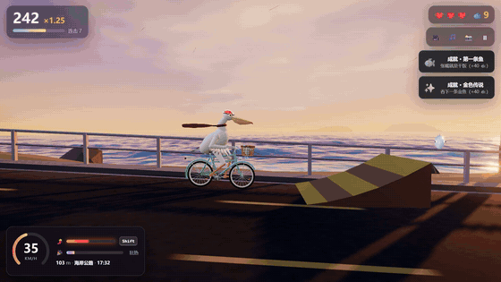

# Pelican Ride — A Coastal Bike Adventure（鹈鹕骑单车）

[中文](README.md) | **English**

A white pelican in a helmet and a red scarf rides a vintage bicycle along the coast, chasing fish, launching off ramps and pulling air tricks.
A real-time 3D endless runner where the models, terrain, sky, ocean, sound effects and music are all generated by code — there are no external assets.

**Play it: <https://pelicanride.vercel.app/?lang=en>** (中文 / English)

> This project was made by Fable 5.2.

[](https://pelicanride.vercel.app/promo.mp4)

▶ [Watch the full 32-second trailer (with sound)](https://pelicanride.vercel.app/promo.mp4) — captured frame by frame from the running game; the audio is the game's own synthesized music and sound effects. The captions are bilingual.

## How to play

Catch fish to build a combo; the higher the combo, the higher the multiplier. Fill the Frenzy meter for a rain of fish and double score. Hitting a hazard costs a heart, and the run ends when all three are gone.
Fish you catch go into your wallet; spend them in the Garage on hats, glasses, scarves, paint, trails and upgrades.

| Key | Action |
|---|---|
| `A` `D` / `←` `→` | Steer |
| `W` / `S` | Pedal hard / brake |
| `Space` | Jump; press again in the air to flap (double jump); hold in the air to glide |
| `T` | Air tricks: backflip, with `←` `→` a spin, with `↑` a superman; hold on the ground for a wheelie |
| `Shift` | Chili boost: invincible, smashes through hazards |
| `B` | Bell: shoo the gulls |
| `H` | Squawk: scare off crabs and startle fish out of the sea |
| `C` `P` `M` | Camera / pause / music |
| `K` `F` `U` `N` | Screenshot / fullscreen / hide UI / skip ahead 3 hours |

Touch controls and gamepads are supported.

## What's in it

- **Three modes**: Adventure, Daily Run (the same track for everyone each day), and Zen Ride (no failing, adjustable time and weather, autopilot when idle)
- **Six zones**: Coast Road, Fishing Village, Palm Beach, Lighthouse Cliffs, Sea Bridge, Blossom Hill
- **Weather and events**: day/night cycle, rain and thunder, rainbows, aurora, shooting stars, breaching whales, dolphins, milestone fireworks
- **Progression**: 37 achievements, rotating missions, cosmetics and five upgrades; progress is saved in your browser
- **Bilingual**: picks Chinese or English from your browser language; switch on the title screen or in Settings, or force it with `?lang=en` / `?lang=zh`

## Tech

- [three.js](https://threejs.org/) with custom shaders: day/night sky with procedural clouds, Gerstner ocean waves, and a road with street-lamp pools and wet-weather reflections
- Fully procedural pelican and bicycle: two-bone IK for pedalling and steering, a spring neck, a Verlet cloth scarf
- An endless track streamed in chunks, with each chunk's scenery merged into a single draw call
- All sound effects synthesized live with WebAudio, plus generative music whose tempo follows your speed and combo
- The build output is a single `dist/index.html` that runs offline

## Development

```bash
npm install
npm run build      # writes dist/index.html — just open it
npm run dev        # unminified debug build
```

`tools/` contains headless-Chrome scripts (they need a local Chrome; set `CHROME_PATH` or edit the path in the scripts if yours differs):

```bash
npm run test:keys          # real-keypress smoke test (pass `en` to test the English build)
npm run test:sim           # long fast-forward autopilot simulation
node tools/promo-video.mjs # re-record the trailer (needs ffmpeg; set FFMPEG to its path)
```

How the trailer is recorded: the game clock is swapped for a virtual clock and stepped frame by frame for screenshots, while the game's `AudioContext` is swapped for an `OfflineAudioContext` that renders the soundtrack offline; ffmpeg then muxes the two. The result doesn't depend on the recording machine's frame rate.

## Credits

The idea and UI style were inspired by [riba2534's pelican-on-a-bike demo](https://github.com/riba2534/claude-opus-5-5-demo); the code in this repository was written independently.
The "ask a model to draw a pelican riding a bicycle" meme comes from [Simon Willison's benchmark](https://simonwillison.net/tags/pelican-riding-a-bicycle/).

## Author

- GitHub: [@Xiobio](https://github.com/Xiobio)
- X: [@JunquanB](https://x.com/JunquanB)

## License

[MIT](LICENSE)
